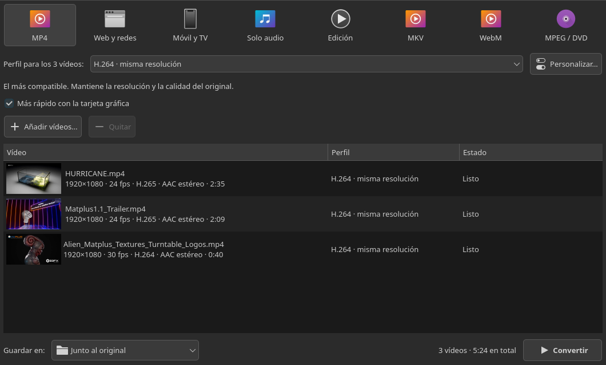
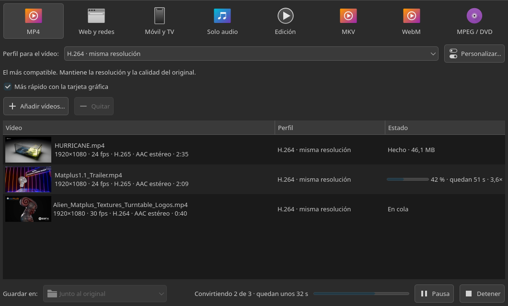
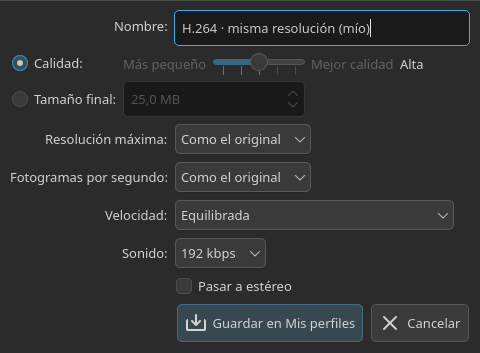
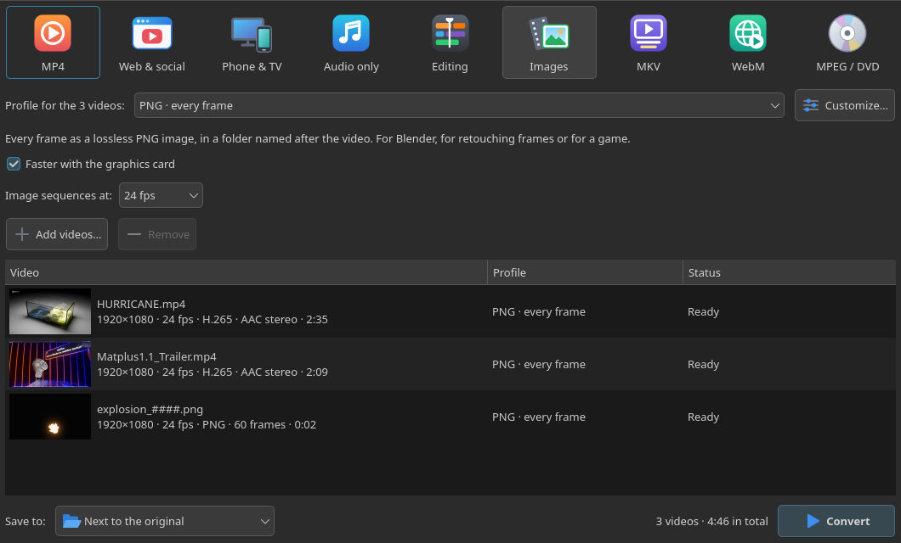

# Konvi

Conversor de vídeo para Linux, pensado para que sea lo más fácil posible: arrastras los
vídeos, eliges a qué los quieres pasar y pulsas **Convertir**. La idea es la de AVS
Video Converter (una fila de destinos y perfiles listos para usar), con lo que hace bien
HandBrake por dentro, y con el aspecto nativo de tu escritorio (Plasma, GNOME...).

También pasa **secuencias de imágenes a vídeo** (el render de Blender, `render_0001.png`…)
y **vídeo a imágenes** (cada fotograma en PNG, JPEG o TIFF).

Solo convierte: no recorta, no une vídeos ni añade subtítulos.



<table>
<tr>
<td width="62%"></td>
<td></td>
</tr>
<tr>
<td>Convirtiendo: progreso de cada vídeo y de toda la tanda, con pausa y detener.</td>
<td>«Personalizar…»: calidad o tamaño final, resolución, fps y sonido.</td>
</tr>
</table>

En inglés si el sistema no está en español (aquí, sacando los fotogramas a PNG):



Está en **español y en inglés**: si el sistema está en español, sale en español; en
cualquier otro idioma, en inglés. Las traducciones están en `konvi/i18n_en.py`, y
`tests/test_i18n.py` falla si algún texto se queda sin traducir.

## Cómo se usa

1. **Arrastra** vídeos o carpetas enteras a la ventana (o «Añadir vídeos…», o clic derecho
   en Dolphin → «Convertir con Konvi»).
2. **Elige el destino** en la fila de arriba (MP4, MKV, WebM, Edición, Imágenes, MPEG/DVD,
   Web y redes, Móvil y TV, Solo audio) y el **perfil** en el desplegable. Pasa el ratón por
   encima de cada cosa: todo explica lo que hace.
3. **Convertir.** Se puede pausar, detener, y seguir añadiendo vídeos mientras convierte.

El perfil se aplica a todos los vídeos de la lista, o solo a los seleccionados si
seleccionas algunos: así se puede pasar uno a MP4 y otro a MP3 en la misma tanda.

**Ajustes…** permite cambiar la calidad (o pedir un tamaño final en MB), la resolución
máxima, los fps, la velocidad y el audio, y guardarlo en **Mis perfiles**.

Los vídeos se guardan junto al original o en la carpeta que elijas. **Nunca se sobrescribe
nada**: si el nombre existe, se añade `(2)`, `(3)`… Mientras se convierte, el fichero se
llama `nombre.konvi-tmp.mp4` y solo recibe su nombre al terminar bien: un vídeo a medias
nunca parece terminado.

## Perfiles

| Destino | Perfiles |
|---|---|
| **MP4** | H.264 (misma resolución, 1080p, 720p, 480p), H.265, AV1, H.264 sin pérdida |
| **MKV** | H.264, H.265 y AV1 con **todas** las pistas de audio y subtítulos; FFV1 sin pérdida |
| **WebM** | VP9, AV1 |
| **Edición** | DNxHR HQ y LB para DaVinci Resolve, ProRes 422 HQ y Proxy |
| **MPEG / DVD** | MPEG-2, DVD PAL |
| **Web y redes** | YouTube/Vimeo, WhatsApp/Telegram, Discord (< 20 MB, lo que permite la cuenta gratuita), correo (< 25 MB) |
| **Móvil y TV** | Móvil 1080p y 720p, Smart TV hasta 4K (H.265) |
| **Solo audio** | MP3, M4A (AAC), Opus, FLAC, WAV |
| **Imágenes** | PNG, JPEG o TIFF de cada fotograma; JPEG de una imagen por segundo |

## Secuencias de imágenes

**De imágenes a vídeo.** Arrastra la carpeta del render, todos sus fotogramas o uno solo:
con un fotograma se coge la secuencia entera, como en DaVinci. Cada secuencia sale en la
lista como un vídeo (`render_####.png · 250 fotogramas`) y se convierte con cualquier perfil.

- Las imágenes no dicen a qué velocidad van: **«Secuencias de imágenes a: 24 fps»** (aparece
  cuando hay alguna en la lista) elige la cadencia. 24 de serie, como Blender; se recuerda.
- Vale cualquier relleno (`0001`, `1`), con o sin prefijo, y con `%`, `[` o espacios en el
  nombre. Si **faltan fotogramas**, avisa de cuáles y el vídeo se los salta (se leen a
  través de enlaces numerados seguidos en una carpeta temporal, que se borra al terminar).
- **EXR**: Blender los guarda en luz lineal y ffmpeg no la convierte (un gris medio saldría
  a 55 en vez de 128, todo oscuro). Konvi la pasa a sRGB con `zscale`. Es la sRGB estándar,
  no la vista AgX/Filmic de Blender: para el aspecto exacto del render, mejor PNG.
- Clic derecho → «Reproducir la secuencia» (o doble clic) la reproduce a los fps elegidos
  en el visor integrado (el [seqview](https://github.com/zebus3d/dolphin-video-tools), sin
  instalarlo aparte): carga en RAM para ir a tiempo real, zoom con la rueda, arrastrar para
  recorrerla (si estaba en marcha, sigue al soltar), un clic quieto en la imagen o Espacio para
  pausar y reproducir, ← → (Mayús+← → salta al principio o al final), A para el fondo de cuadros,
  R / G / B / Mayús+A para ver un canal y C para volver al color, E / Mayús+E para la exposición
  (en lineal: en un EXR saca las luces quemadas), Y / Mayús+Y para la gamma, 0 para quitarlas, y
  Ctrl+R (o el botón ⟳) para añadir los fotogramas nuevos de un render que sigue en marcha y
  volver a leer los que se hayan re-renderizado. Lo que Qt no sabe leer (EXR sin
  `kimageformats`) lo lee ffmpeg.
- En el visor, el botón de la cámara (o V) abre a la derecha los **efectos de cámara**, para
  ver cómo quedaría la secuencia rodada con una cámara de verdad: distorsión, aberración
  cromática, glow (con cola larga, como los «exponential glow» de Nuke), viñeteado,
  halación, grano de película o ruido de sensor, y color, brillo y
  contraste. Cada efecto se enciende con su casilla, se pliega con su flecha y vuelve a sus
  valores con su botón; Ctrl+clic en un deslizador lo devuelve a su valor. Arriba hay cámaras
  completas (cine digital, 35 mm 500T o 250D, 16 mm, Super 8, objetivo antiguo, réflex, cámara
  de acción, móvil). Los valores salen de medidas reales (LensTip, Imatest, lensfun, las fichas
  de Kodak VISION3, DxOMark). M los silencia para comparar con el original; al abrir vienen
  silenciados. También están en el menú del botón derecho de la imagen.

**De vídeo a imágenes.** El destino **Imágenes** guarda cada fotograma en una carpeta con el
nombre del vídeo (`clip/clip_0001.png`…). PNG y TIFF conservan la transparencia y los 16
bits si el original tiene más de 8; JPEG ocupa mucho menos. «Personalizar…» deja elegir la
resolución y cuántas imágenes por segundo (todas, o una cada segundo o cada 10 s).

Lo que hace por dentro, tomado de HandBrake:

- **Calidad constante** (CRF): cada vídeo usa los bits que necesita. Con «tamaño final»,
  calidad constante con tope de bitrate, calculado para que el fichero quepa siempre.
- **Nunca agranda**: «1080p» reduce si el original es mayor y lo deja como está si es menor.
  En vídeos verticales del móvil se refiere al lado corto.
- **Desentrelaza** solo si el original es entrelazado (DVD, cámaras antiguas).
- **El audio se copia tal cual** si ya está en el formato pedido; si no, se convierte. Los
  MKV de «todas las pistas» copian todo el audio sin tocarlo, y «Smart TV» deja una pista
  estéreo y además el sonido envolvente original (como los perfiles «Surround» de HandBrake).
- **Tamaño final con resolución automática**: Discord y correo eligen la resolución según
  lo que dure el vídeo (con 25 MB: 30 s → 1080p, 1 min → 720p, 2 min → 540p, 5 min → 360p),
  igual que los perfiles «Social» de HandBrake.
- **H.265 y AV1 siempre en 10 bits**, con el afinado de x265 y SVT-AV1 de los presets
  oficiales de HandBrake (`preset/preset_builtin.json`): más detalle a igual tamaño.
- Conserva capítulos, metadatos, la rotación del móvil y los 10 bits en H.265/AV1.
- Con la **tarjeta gráfica** (NVIDIA NVENC o VAAPI de AMD/Intel) H.264 y H.265 van mucho
  más rápido; viene activada siempre que la haya (desmarcarla vale para esa sesión). Con
  NVENC la calidad usa su propia escala, medida con VMAF sobre vídeos reales: CQ = CRF + 3
  da la misma calidad que el procesador (el +5 de HandBrake se quedaba corto). Konvi comprueba al arrancar qué funciona de verdad (no basta con que ffmpeg
  lo liste) y, si la tarjeta falla a mitad, vuelve a convertir ese vídeo con el procesador.
- No deja que el equipo se suspenda mientras convierte.

## Qué hay que instalar en el sistema

Konvi **no trae ffmpeg ni Qt dentro**: usa los del sistema.

| Programa | Para qué |
|---|---|
| **ffmpeg** (con `ffprobe`) | toda la conversión. Tiene que traer `libx264`, `libx265`, `libsvtav1`, `libvpx`, `libopus` y `libmp3lame`; y `zscale` (libzimg) para los EXR |
| **Python 3.10 o más nuevo** | Konvi está escrito en Python |
| **PySide6** (Qt 6 para Python) | la ventana |
| **numpy** | el visor de secuencias (exposición, canales, EXR en coma flotante). Sin él Konvi no arranca |
| Driver de NVIDIA, o `libva` con el driver de tu gráfica | solo para usar la tarjeta gráfica (opcional) |

```bash
# Arch / EndeavourOS / Manjaro (probado)
sudo pacman -S --needed ffmpeg python pyside6 python-numpy
#   tarjeta gráfica: NVIDIA ya va con el driver «nvidia»; AMD: libva-mesa-driver; Intel: intel-media-driver

# Fedora: el ffmpeg oficial ("ffmpeg-free") NO trae H.264 ni H.265.
# Hay que cambiarlo por el de RPM Fusion:
sudo dnf install https://mirrors.rpmfusion.org/free/fedora/rpmfusion-free-release-$(rpm -E %fedora).noarch.rpm
sudo dnf swap ffmpeg-free ffmpeg --allowerasing
sudo dnf install python3-pyside6 python3-numpy

# Debian 13 / Ubuntu 24.10 o más nuevo
sudo apt install ffmpeg python3-pyside6.qtwidgets python3-pyside6.qtnetwork python3-numpy

# openSUSE Tumbleweed: como en Fedora, el ffmpeg con H.264/H.265 está en Packman
sudo zypper install opi && opi codecs
sudo zypper install python3-pyside6 python3-numpy
```

Solo está probado en Arch; en las otras distros son los nombres de sus paquetes, sin
haberlo probado allí. Para comprobar que tu ffmpeg trae lo necesario:

```bash
ffmpeg -hide_banner -encoders | grep -E 'libx264|libx265|libsvtav1|libvpx-vp9|libopus|libmp3lame'
```

Si falta alguno, los perfiles que lo usan fallarán con un error que lo dice.

## Instalar

```bash
git clone git@github.com:zebus3d/konvi.git
cd konvi
./install.sh
```

No necesita permisos de administrador. Instala en tu usuario:

- el programa en `~/.local/share/konvi` y la orden `konvi` en `~/.local/bin`;
- Konvi en el menú de aplicaciones, con su icono;
- «Convertir con Konvi» en el submenú **zebus3d** del clic derecho de Dolphin, para vídeos,
  audios, imágenes y carpetas
  (cierra y vuelve a abrir Dolphin para que aparezca).

`./uninstall.sh` lo quita todo menos tus perfiles (`~/.config/konvi`).

Para probarlo sin instalar: `./run.sh [vídeos…]`.

Si abres Konvi cuando ya está abierto (por ejemplo, desde Dolphin), los vídeos se
añaden a la ventana que ya tenías.

## Dónde guarda cosas

| Qué | Dónde |
|---|---|
| Ajustes (último perfil, carpeta, tamaño de la ventana) | `~/.config/konvi/konvi.conf` |
| Tus perfiles | `~/.config/konvi/presets.json` |
| Qué tarjeta gráfica funciona (se repite si cambia ffmpeg o el kernel) | `~/.cache/konvi/encoders.json` |
| Errores internos | `~/.cache/konvi/konvi.log` |

## Cómo está hecho

```
konvi/core/   sin Qt, con pruebas: perfiles, lectura con ffprobe, construcción del
              comando de ffmpeg (command.py, una función pura), progreso, nombres,
              detección de la tarjeta gráfica, el estado de cada trabajo y las
              secuencias de imágenes (sequence.py)
konvi/ui/     Qt (PySide6) con el estilo del sistema: ventana, cola, «Ajustes…» y el
              ejecutor (un ffmpeg detrás de otro con QProcess; pausa con SIGSTOP)
konvi/icons/  iconos propios en SVG: se ven igual en Plasma, GNOME o cualquier escritorio
```

Pruebas:

```bash
python3 -m unittest tests.test_core tests.test_i18n   # el motor y las traducciones, en milisegundos
python3 -m unittest tests.test_real_conversions  # cada perfil con ffmpeg de verdad (~1 min)
python3 -m unittest tests.test_ui                # la ventana, sin pantalla
python3 -m unittest tests.test_seqview           # el visor de secuencias, sin pantalla
```

## Licencia

Konvi es software libre: puedes usarlo, estudiarlo, modificarlo y redistribuirlo bajo los
términos de la [GNU General Public License](LICENSE), versión 3 o (a tu elección) cualquier
versión posterior. Es la misma familia de licencias que ffmpeg (compilado con x264/x265) y
HandBrake.
